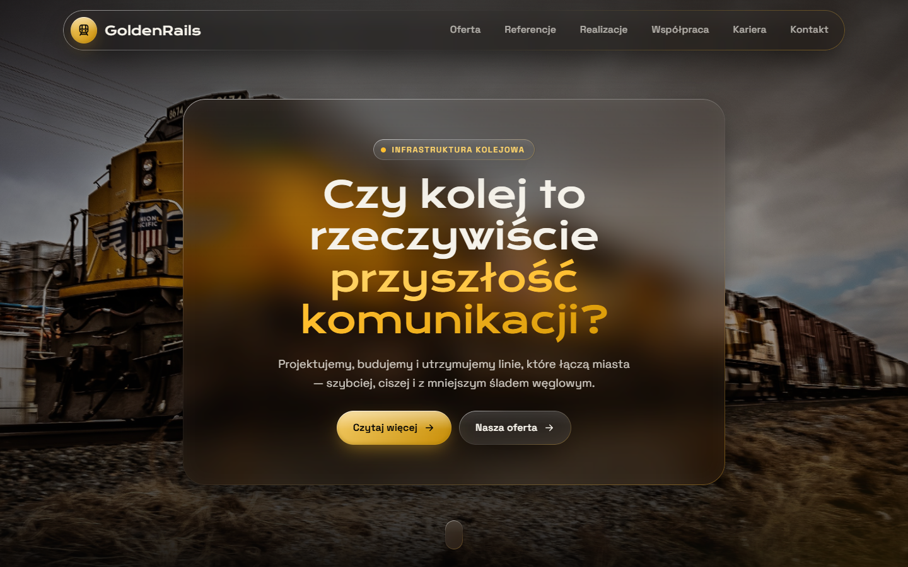
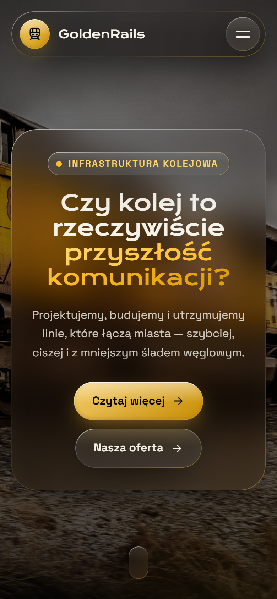

## Table of contents

- [General info](#general-info)
- [Technologies](#technologies)
- [Getting started](#getting-started)
- [Project structure](#project-structure)
- [Screenshots](#screenshots)
- [Author](#author)
- [Live](#live)

## General info

GoldenRails — railway company webpage. Dark theme with yellow-gold accents and "liquid glass" UI
(frosted, refracting panels with light rims), smooth scroll-driven reveals and animated counters.

## Technologies

- Next.js 16 (App Router, static export)
- React 19 + TypeScript
- SCSS (CSS Modules + shared tokens & mixins)

## Getting started

```bash
npm install
npm run dev      # http://localhost:3000
npm run build    # static site in ./out
```

Pushing to `main` deploys to GitHub Pages via `.github/workflows/deploy.yml`
(repo Settings → Pages → Source: **GitHub Actions**).

## Project structure

```
src/
  app/         # routes: /, /oferta, /referencje, /realizacje, /wspolpraca, /kariera, /kontakt
  components/  # Navbar, Footer, Stats, ReferenceGallery, ImageTextSection, ...
  styles/      # _tokens.scss (colors, sizes), _mixins.scss (liquid-glass, reveal), globals.scss
  data/        # site content (menu, stats, offer, references)
  assets/      # images
```

## Screenshots

- Desktop version :computer:



- Mobile version :iphone:



## Author

Marcin Godlewski

## Live :star2:

https://goldipl.github.io/Railway_Webpage/
